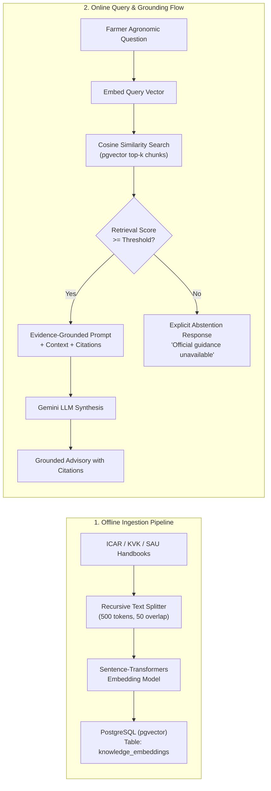

# 03. System Architecture Specification — AgriMind AI

## Document Information
- **Project Name:** AgriMind AI
- **Document Version:** 2.0.0 (Architecture Finalization Specification)
- **Architecture Pattern:** Decoupled Multi-Tier Architecture (Client SPA + Modular REST API Gateway + Intelligence Tier)
- **Target Audience:** All Engineering Team Members, Academic Supervisors, AI Coding Agents

---

## 1. High-Level System Architecture

AgriMind AI is engineered as a **decoupled, multi-tier cyber-physical architecture**. The system enforces strict separation of concerns between client visualization (React SPA & Three.js 3D Scene), API routing and transactional business logic (FastAPI), primary transactional persistence (PostgreSQL), vector/context persistence (PostgreSQL with `pgvector`), machine learning inference (Scikit-learn / XGBoost / PyTorch), and LLM reasoning (Gemini API with native tool calling).

```mermaid
flowchart TD
    subgraph ClientLayer ["1. Client Tier (Browser / PWA)"]
        User(["👨‍🌾 Farmer / User"])
        subgraph FrontendApp ["AgriMind Frontend Application (React + Vite + TypeScript)"]
            UI["Dashboard & Form Components<br/>(React 18 + Tailwind CSS)"]
            Scene3D["3D Agricultural Digital Twin<br/>(Three.js + React Three Fiber + Drei)"]
            Fallback2D["2D Canvas / Map Fallback View<br/>(Low-End / Non-WebGL Devices)"]
            VoiceModule["Multilingual Voice Interface<br/>(Web Speech API)"]
            ClientStore["Client Cache & Offline Store<br/>(IndexedDB / Service Worker)"]
        end
        User <--> UI
        User <--> Scene3D
        User <--> Fallback2D
        User <--> VoiceModule
    end

    subgraph GatewayLayer ["2. Application Gateway & Security"]
        APIGateway["FastAPI REST API Gateway<br/>(CORS, Rate Limiting, JWT Auth Middleware)"]
    end

    subgraph BackendCore ["3. Backend Core Domain Services (FastAPI + Pydantic)"]
        AuthService["Authentication & User Service"]
        FarmService["Farm & Plot Management Service"]
        CropService["Crop & Agronomic Intelligence Service"]
        FinanceService["Farm Finance & Profitability Service"]
        OpsService["Operations Service<br/>(Inventory, Labour, Equipment)"]
        MarketService["Market & FPO Collective Service"]
        MemoryService["Farm Memory Service"]
    end

    subgraph DataPersistence ["4. Data & State Persistence Tier"]
        RDBMS[("Primary Relational Database<br/>(PostgreSQL 15+)")]
        VectorStore[("Vector Store Extension<br/>(PostgreSQL with pgvector)")]
        ObjectStorage[("Object Storage<br/>(Local Disk / Cloud S3)")]
    end

    subgraph IntelligenceTier ["5. AI & Machine Learning Services"]
        AgentCore["Central Agentic AI Assistant<br/>(Gemini API + Native Tool Calling)"]
        RAGSystem["Agricultural RAG Pipeline<br/>(Embeddings + Grounded Document Retrieval)"]
        MultiTaskML["Central Multi-Task ML Service<br/>(Crop Suitability, Yield, Water, Risk)"]
        MarketML["Market Price Forecasting Service<br/>(Time-Series Regressors)"]
    end

    subgraph ExternalServices ["6. External APIs & Knowledge Sources"]
        DiseaseAPI["Crop Disease Detection API<br/>(Existing Integration – Pending Audit)"]
        WeatherAPI["Meteorological Service<br/>(OpenWeatherMap / IMD)"]
        MandiAPI["Agricultural Mandi Prices<br/>(Agmarknet / Data.gov.in)"]
        AgriDocs["Verified Agricultural Manuals<br/>(ICAR, SAU, KVK Packages of Practices)"]
    end

    %% Client to Gateway
    UI <-->|HTTPS / JSON REST| APIGateway
    Scene3D <-->|Plot Coordinates & State| APIGateway
    Fallback2D <-->|2D Spatial Metadata| APIGateway
    VoiceModule <-->|Transcribed Text| APIGateway

    %% Gateway to Domain Services
    APIGateway --> AuthService
    APIGateway --> FarmService
    APIGateway --> CropService
    APIGateway --> FinanceService
    APIGateway --> OpsService
    APIGateway --> MarketService
    APIGateway --> AgentCore

    %% Domain Services to Persistence
    AuthService & FarmService & CropService & FinanceService & OpsService & MarketService <-->|SQLAlchemy ORM| RDBMS
    AgentCore & MemoryService <-->|Semantic Similarity Queries| VectorStore
    FarmService & CropService <-->|Soil Cards, Crop Photos, GLTF Models| ObjectStorage

    %% Agentic AI Core Flow
    AgentCore <-->|Native Tool Calling| FarmService & CropService & FinanceService & OpsService & MarketService
    AgentCore <-->|Retrieve Grounded Context| RAGSystem
    RAGSystem <-->|Dense Vector Search| VectorStore
    AgriDocs -.->|Document Chunking & Ingestion| RAGSystem

    %% Domain Services to ML & External APIs
    CropService & FarmService <-->|Tabular Inferences| MultiTaskML
    MarketService <-->|Price Trends| MarketML
    CropService <-->|Proxy Leaf Diagnosis| DiseaseAPI
    CropService -.->|Live Forecasts| WeatherAPI
    MarketService -.->|Daily Mandi Prices| MandiAPI
```



---

## 2. Modular Agentic AI Architecture

The Agentic AI Assistant initially follows a **clean, single-agent modular tool-calling architecture**. Multi-agent systems (such as multi-actor swarms) introduce unnecessary orchestration overhead for this scope and are avoided unless a concrete operational advantage is proven.

```
+-----------------------------------------------------------------------------------------+
|                              AGENTIC AI MODULAR EXECUTION FLOW                          |
+-----------------------------------------------------------------------------------------+
|                                                                                         |
|   1. FARMER INPUT                                                                       |
|      Farmer asks natural language question (via Text or Voice).                         |
|      "Can I afford to sow 3 acres of Maize on Plot 2 right now?"                       |
|                                     │                                                   |
|                                     ▼                                                   |
|   2. LLM REASONING & INTENT PARSING (Google Gemini API)                                 |
|      LLM inspects prompt, evaluates conversation history, and determines required data.  |
|      Emits native function/tool call intents with structured arguments.                 |
|                                     │                                                   |
|                                     ▼                                                   |
|   3. NATIVE TOOL CALLING DISPATCH                                                       |
|      • Tool 1: get_farm_finance_summary(farm_id="f1")                                   |
|      • Tool 2: check_inventory_stock(category="Seeds", crop="Maize")                    |
|      • Tool 3: get_plot_details(plot_id="p2")                                           |
|                                     │                                                   |
|                                     ▼                                                   |
|   4. FASTAPI ENDPOINTS & DOMAIN SERVICES                                                |
|      Approved FastAPI services execute requests against PostgreSQL and ML models.       |
|      Returns structured JSON observations back to the LLM.                              |
|                                     │                                                   |
|                                     ▼                                                   |
|   5. SYNTHESIS, MEMORY CONTEXT & CITATIONS                                              |
|      LLM synthesizes tool outputs + RAG context + Farm Memory into a grounded answer.   |
|      "You have ₹25,000 cash balance. 3 acres of Maize requires ₹36,000 upfront.         |
|       You currently have 0 kg seed in inventory. Consider booking shared tillage..."     |
+-----------------------------------------------------------------------------------------+
```

*Note on Future Evolution:* **LangGraph** may be evaluated in later phases if complex, stateful multi-turn human-in-the-loop agent workflows become necessary. For baseline development, native Gemini tool calling provides low latency and maximum reliability.

---

## 3. RAG Knowledge Architecture & Realistic Hallucination Reduction

The Retrieval-Augmented Generation (RAG) system grounds agronomic answers in verified documentation:



### Hallucination Reduction Principles
- **No Unverifiable Claims:** The platform does not claim "zero hallucinations."
- **Source Citations:** Every advisory response must reference the source manual, edition, and page/section.
- **Explicit Uncertainty & Abstention:** When document relevance scores fall below a calibrated threshold, the assistant explicitly states that official guidance is unavailable rather than guessing.

---

## 4. Digital Twin Architecture: Three.js & React Three Fiber

The 3D Digital Twin replaces the CSS 2.5D prototype with a true hardware-accelerated WebGL scene:

```
PROTOTYPE (agrimind_ai_frontend_v5.html)
  CSS 3D perspective transforms on <div> containers.
  - Cosmetic 2.5D visual preview only.
  - Cannot scale to real GPS polygon plots, terrain elevations, or lighting.
                                      │
                                      ▼  MIGRATION PATH
PRODUCTION ARCHITECTURE
  React 18 + Three.js + React Three Fiber (R3F) + @react-three/drei
  - Canvas: <Canvas> mounting hardware-accelerated WebGL 2.0 context.
  - Controls: OrbitControls with constrained polar and azimuthal limits.
  - Geometry: Extruded polygon plots generated from GeoJSON boundary coordinates.
  - Materials: MeshStandardMaterial supporting procedural moisture/fertility heatmaps.
  - Assets: Low-poly GLTF/GLB models for crops across 4 growth stages, farm structures, trees.
  - Interaction: Raycasting on pointer events to select and inspect plots.
```

### Measurable Performance Targets & Fallback
- **Desktop Target:** $\ge 45\text{ FPS}$ on standard integrated graphics (Intel UHD / Iris).
- **Mobile Target:** $\ge 30\text{ FPS}$ on mid-tier mobile hardware.
- **Memory Limit:** $\le 150\text{ MB}$ WebGL context heap.
- **Scene Complexity:** Up to 12 distinct polygon plots with procedural meshes.
- **2D Fallback:** Automatic degradation to a 2D Canvas / SVG Map View if WebGL fails or frame rates drop below 20 FPS.

---

## 5. Machine Learning Architecture

```text
1. Central Agricultural Multi-Task Model (Experimental - Member 2):
   - Shared feature extraction backbone for related tabular tasks:
     • Crop Recommendation (Categorical)
     • Expected Yield (Regression)
     • Fertilizer Demand (Multi-output Regression)
     • Irrigation Water Requirement (Regression)
     • Agricultural Risk Score (Multi-label Classification)
   - Mandatory Governance: Must be experimentally compared against single-task
     LightGBM / XGBoost / Random Forest baselines before adoption.

2. Market Price Forecasting Model (Specialist - Member 3):
   - Standalone time-series model (Prophet / ARIMA / XGBoost with lag features).
   - Operates on historical APMC mandi commodity prices independently of plot soil.

3. Crop Disease Detection API (Member 2):
   - Status: Existing Integration – Pending Audit.
   - External CNN service inherited from predecessor KisanSathi prototype.
   - Consumed as a REST proxy; no new CNN fine-tuning in AgriMind AI.
```

---

## 6. Security, Authentication & Multi-Tenancy

1. **Authentication:** Stateless authentication using **JSON Web Tokens (JWT)**. Passwords hashed using `bcrypt`.
2. **Multi-Tenancy Isolation:** Every database entity links to a `farm_id` and `user_id`. All FastAPI database queries strictly enforce tenant ownership filters derived from the verified JWT claims.
3. **Role-Based Access Control (RBAC):**
   - `FARMER`: Manages their own farm, plots, expenses, inventory, and labor records.
   - `EQUIPMENT_PROVIDER`: Manages machinery rental listings and booking confirmations.
   - `FPO_ADMIN`: Manages collective produce pools and member aggregations.
   - `ADMIN`: Platform monitoring and master crop/agronomy catalog management.

---

## 7. Technology Stack Summary (Finalized)

| Layer | Finalized Technology | Rationale |
| :--- | :--- | :--- |
| **Frontend Shell** | React 18 + Vite + TypeScript | Type safety, reactive component lifecycle, large ecosystem. |
| **Styling** | Tailwind CSS | Consistent utility-first styling matching prototype aesthetics. |
| **3D Engine** | Three.js + React Three Fiber + Drei | Declarative WebGL 3D rendering with native React component binding. |
| **Backend API** | Python 3.10+ + FastAPI + Pydantic v2 | High-speed async REST API, auto OpenAPI docs, native Python ML support. |
| **Relational DB** | PostgreSQL 15+ | Enterprise ACID compliance, robust relational data integrity. |
| **Vector Storage** | `pgvector` (PostgreSQL extension) | Direct vector similarity search in primary DB without separate vector store. |
| **Machine Learning** | Scikit-learn + XGBoost (PyTorch when needed) | Robust tabular benchmarks and experimental multi-task deep networks. |
| **AI Assistant** | Google Gemini API (Native Tool Calling) | High-speed LLM reasoning, structured tool invocation, large context window. |
| **Deployment** | Vercel (Frontend) + Railway (Backend & DB) | Streamlined student-friendly PaaS with Git-triggered deployments. |
