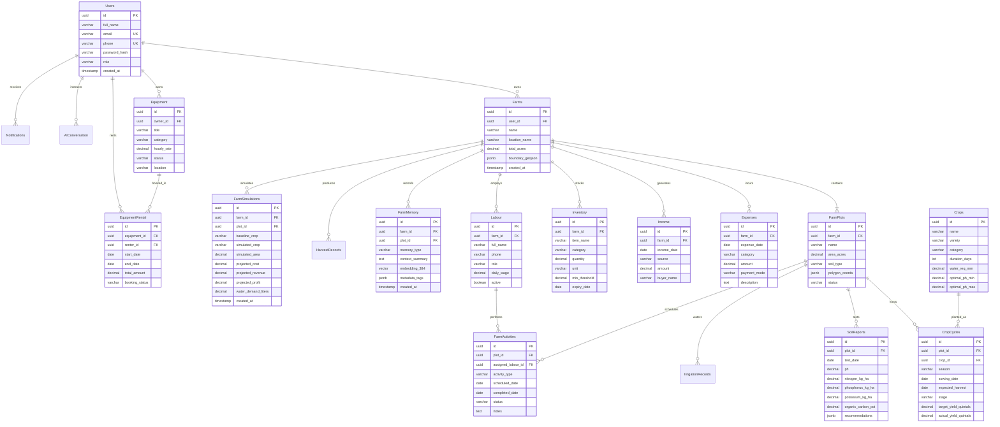

# 06. Database Schema & REST API Design — AgriMind AI

## Document Information
- **Project Name:** AgriMind AI
- **Document Version:** 2.0.0 (Architecture Finalization Specification)
- **Status:** Proposed Architecture & Schema Specification
- **Implementation Notice:** No database tables or API endpoints are currently implemented. This document establishes the formal engineering design for Phase 2 implementation.
- **Target Audience:** All Team Members, Backend Engineers, Evaluators, and AI Coding Agents

---

## 1. Database Architecture & Design Principles

The AgriMind AI relational database is engineered around **PostgreSQL 15+** with the **`pgvector`** extension, adhering to the following structural principles:

1. **User Ownership & Access Control:** Every primary operational entity (`Farms`, `Expenses`, `Inventory`, `Labour`, `FarmMemory`) strictly enforces a foreign key back to `farms.id` and `users.id`. All queries verify that the authenticated JWT user owns the target farm.
2. **Double-Entry Financial Accuracy:** Monetary values (`Expenses`, `Income`, `EquipmentRental`) use `NUMERIC(12, 2)` or integer minor units to eliminate floating-point rounding errors.
3. **Temporal Tracking & Historical Data:** All mutable records contain `created_at` and `updated_at` UTC timestamps, preserving longitudinal history for farm analytics.
4. **Spatial Representation:** Plot boundaries support GeoJSON polygon structures stored in PostgreSQL `JSONB`.
5. **Integrated Vector Persistence:** AI Farming Memory and RAG document embeddings use `vector(384)` columns powered by `pgvector`, eliminating the need for an external vector database.

---

## 2. Entity-Relationship Diagram (Proposed Specification)



---

## 3. Database Entities Specification

The 22 proposed database entities addressing the complete agricultural lifecycle are detailed below:

| # | Entity Name | Purpose & Domain | Key Fields & Types | Indexes & Constraints |
| :-: | :--- | :--- | :--- | :--- |
| **01** | `Users` | User identity & authentication | `id (UUID)`, `email (VARCHAR)`, `phone (VARCHAR)`, `password_hash (VARCHAR)`, `role (VARCHAR)` | Unique: `email`, `phone` |
| **02** | `Farms` | Top-level agricultural landholding | `id (UUID)`, `user_id (UUID)`, `name`, `total_acres (NUMERIC)`, `boundary_geojson (JSONB)` | Index on `user_id` |
| **03** | `FarmPlots` | Subdivided fields within a farm | `id (UUID)`, `farm_id (UUID)`, `name`, `area_acres`, `soil_type`, `polygon_coords (JSONB)`, `status` | FK to `Farms` |
| **04** | `Crops` | Master agricultural catalog | `id (UUID)`, `name`, `variety`, `category`, `duration_days`, `water_req_mm`, `optimal_ph_min`, `optimal_ph_max` | Master seed catalog |
| **05** | `CropCycles` | Seasonal cultivation on a plot | `id (UUID)`, `plot_id (UUID)`, `crop_id (UUID)`, `season`, `sowing_date`, `stage`, `target_yield`, `actual_yield` | FK to `FarmPlots`, `Crops` |
| **06** | `SoilReports` | Chemical soil laboratory records | `id (UUID)`, `plot_id (UUID)`, `test_date`, `ph`, `nitrogen_kg_ha`, `phosphorus_kg_ha`, `potassium_kg_ha`, `oc_pct` | Index on `(plot_id, test_date)` |
| **07** | `FarmActivities`| Field tasks (weeding, spraying) | `id (UUID)`, `plot_id (UUID)`, `assigned_labour_id (UUID)`, `activity_type`, `scheduled_date`, `status` | FK to `FarmPlots`, `Labour` |
| **08** | `IrrigationRecords`| Water application events | `id (UUID)`, `plot_id (UUID)`, `date`, `water_volume_liters`, `method`, `duration_minutes` | FK to `FarmPlots` |
| **09** | `WeatherRecords`| Cached micro-climate forecasts | `id (UUID)`, `farm_id (UUID)`, `date`, `temp_max`, `temp_min`, `humidity`, `rainfall_mm` | Index on `(farm_id, date)` |
| **10** | `Expenses` | Operational & input cost ledger | `id (UUID)`, `farm_id (UUID)`, `date`, `category`, `amount (NUMERIC(12,2))`, `payment_mode`, `description` | FK to `Farms` |
| **11** | `Income` | Revenues from produce & subsidies | `id (UUID)`, `farm_id (UUID)`, `date`, `source`, `amount (NUMERIC(12,2))`, `buyer_name` | FK to `Farms` |
| **12** | `Inventory` | Inputs stock (seeds, fertilizer) | `id (UUID)`, `farm_id (UUID)`, `item_name`, `category`, `quantity`, `unit`, `min_threshold`, `expiry_date` | Alert: `quantity < min_threshold` |
| **13** | `InventoryTransactions`| Stock audit trail | `id (UUID)`, `inventory_id (UUID)`, `transaction_type (IN/OUT)`, `quantity`, `reference_activity_id` | Audit tracking |
| **14** | `Equipment` | Farm machinery for sharing | `id (UUID)`, `owner_id (UUID)`, `title`, `category`, `hourly_rate`, `status`, `location` | FK to `Users` |
| **15** | `EquipmentRental`| Peer-to-peer machinery bookings| `id (UUID)`, `equipment_id (UUID)`, `renter_id (UUID)`, `start_date`, `end_date`, `total_amount`, `status` | FK to `Equipment`, `Users` |
| **16** | `Labour` | Worker profiles & daily rates | `id (UUID)`, `farm_id (UUID)`, `full_name`, `phone`, `role`, `daily_wage`, `active` | FK to `Farms` |
| **17** | `LabourAttendance`| Daily worker attendance logs | `id (UUID)`, `labour_id (UUID)`, `date`, `status (PRESENT/ABSENT)`, `plot_id (UUID)` | Index on `(labour_id, date)` |
| **18** | `MarketPrices` | APMC mandi market commodity rates| `id (UUID)`, `commodity`, `market_center`, `state`, `modal_price`, `min_price`, `max_price`, `date` | Index on `(commodity, date)` |
| **19** | `HarvestRecords`| Harvest yields & storage logs | `id (UUID)`, `cycle_id (UUID)`, `harvest_date`, `quantity_quintals`, `storage_facility`, `moisture_pct` | FK to `CropCycles` |
| **20** | `FarmMemory` | Long-term episodic & semantic log| `id (UUID)`, `farm_id (UUID)`, `plot_id (UUID)`, `memory_type`, `context_summary`, `embedding_384 (VECTOR)` | `pgvector` cosine index |
| **21** | `FarmSimulations`| Saved What-If & profit runs | `id (UUID)`, `farm_id (UUID)`, `plot_id (UUID)`, `baseline_crop`, `simulated_crop`, `projected_profit` | FK to `Farms` |
| **22** | `AIConversation`| Chat interaction sessions | `id (UUID)`, `user_id (UUID)`, `title`, `messages_json (JSONB)`, `created_at` | FK to `Users` |

---

## 4. RESTful API Architecture & Conventions

### 4.1 Common Identifiers & Versioning
- All endpoints are versioned with the prefix `/api/v1/`.
- Resource entities use standard **UUID v4** as primary identifiers (`f81d4fae-7dec-11d0-a765-00a0c91e6bf6`).
- Paths use **kebab-case, plural nouns** for resources (e.g., `/api/v1/farm-plots`, `/api/v1/crop-cycles`).

### 4.2 Authentication & Security
- All private endpoints require the `Authorization: Bearer <JWT>` header.
- FastAPI dependency injection validates JWT claims, extracts `user_id`, and verifies tenant ownership before delegating to service logic.

### 4.3 Standard Request & Response Envelopes

#### Success Envelope (HTTP 200 / 201)
```json
{
  "success": true,
  "data": { ... },
  "message": "Resource successfully retrieved / created",
  "timestamp": "2026-11-19T16:00:00Z"
}
```

#### Error Envelope (HTTP 400 / 401 / 403 / 404 / 422 / 500)
```json
{
  "success": false,
  "error": {
    "code": "VALIDATION_ERROR",
    "message": "Input validation failed on one or more fields.",
    "details": [
      {
        "field": "nitrogen_kg_ha",
        "issue": "Value must be greater than or equal to 0"
      }
    ]
  },
  "timestamp": "2026-11-19T16:00:00Z"
}
```

---

## 5. Key Endpoint Specifications & Schemas

### 5.1 Farm Registration & 3D Boundaries
- **Route:** `POST /api/v1/farms` | **Auth:** `Bearer <JWT>` (Member 1)

```json
// Request
{
  "name": "Green Valley Farm",
  "location_name": "Nashik, Maharashtra",
  "total_acres": 8.5,
  "boundary_geojson": {
    "type": "Polygon",
    "coordinates": [[[73.7898, 19.9975], [73.7925, 19.9975], [73.7925, 19.9950], [73.7898, 19.9950], [73.7898, 19.9975]]]
  }
}

// Response (201 Created)
{
  "success": true,
  "data": {
    "id": "f81d4fae-7dec-11d0-a765-00a0c91e6bf6",
    "name": "Green Valley Farm",
    "total_acres": 8.5,
    "created_at": "2026-11-19T16:00:00Z"
  },
  "message": "Farm profile created"
}
```

### 5.2 Smart Crop Recommendation
- **Route:** `POST /api/v1/crops/recommend` | **Auth:** `Bearer <JWT>` (Member 2)

```json
// Request
{
  "plot_id": "plt-12345",
  "soil_parameters": {
    "nitrogen_kg_ha": 140.0,
    "phosphorus_kg_ha": 35.0,
    "potassium_kg_ha": 210.0,
    "ph": 6.8,
    "organic_carbon_pct": 0.65
  },
  "season": "Kharif"
}

// Response (200 OK)
{
  "success": true,
  "data": {
    "recommended_crops": [
      {
        "crop_name": "Maize",
        "suitability_score": 0.91,
        "predicted_yield_quintals_per_acre": 20.5,
        "reason": "Optimal nitrogen-potassium balance and favorable Kharif moisture profile."
      }
    ]
  },
  "message": "Crop recommendation generated"
}
```

### 5.3 Farm What-If Scenario Simulation
- **Route:** `POST /api/v1/digital-twin/simulate` | **Auth:** `Bearer <JWT>` (Member 1 & 3)

```json
// Request
{
  "farm_id": "f81d4fae-7dec-11d0-a765-00a0c91e6bf6",
  "plot_id": "plt-12345",
  "area_acres": 3.0,
  "baseline_crop": "Cotton",
  "simulated_crop": "Maize"
}

// Response (200 OK)
{
  "success": true,
  "data": {
    "baseline": { "crop": "Cotton", "projected_cost": 48000, "projected_revenue": 81000, "net_return": 33000, "water_liters": 450000 },
    "simulated": { "crop": "Maize", "projected_cost": 36000, "projected_revenue": 72000, "net_return": 36000, "water_liters": 280000 },
    "comparison": { "profit_delta": 3000, "water_savings_liters": 170000 }
  },
  "message": "Simulation completed"
}
```

### 5.4 Agentic AI Assistant Turn (Native Tool Calling)
- **Route:** `POST /api/v1/assistant/chat` | **Auth:** `Bearer <JWT>` (Member 4)

```json
// Request
{
  "conversation_id": "conv-9988",
  "prompt": "Can I afford to plant 3 acres of Maize on Plot 2 right now?"
}

// Response (200 OK)
{
  "success": true,
  "data": {
    "reply": "Planting 3 acres of Maize on Plot 2 requires approximately ₹36,000 upfront. Your financial ledger reports a current cash balance of ₹25,000, and your inventory currently has 0 kg of hybrid seed. Consider booking shared tillage on the rental portal to reduce initial machinery expenditure.",
    "tools_executed": [
      { "tool": "get_farm_finances", "status": "SUCCESS" },
      { "tool": "check_inventory_stock", "status": "SUCCESS" }
    ],
    "citations": [
      { "source": "ICAR Kharif Maize Package of Practices (2024)", "section": "Seed Rate & Tillage" }
    ]
  },
  "message": "Turn completed"
}
```

---

## 6. Complete API Route Hierarchy (Proposed)

```text
/api/v1/
├── auth/          (register, login, refresh)
├── farms/         (farm profiles, boundaries, plot hierarchy)
├── plots/         (plot geometry, soil records, active crop)
├── crops/         (crop catalog, recommendation inference)
├── soil/          (soil health reports, amendment advisories)
├── irrigation/    (daily water requirement calculation, watering logs)
├── disease/       (leaf image diagnosis proxy - Pending Audit)
├── weather/       (current conditions, micro-climate forecasts, alerts)
├── digital-twin/  (3D scene manifest, what-if scenario simulations)
├── finance/       (income/expense ledgers, cash flow, profitability)
├── inventory/     (stock balances, low-stock triggers, expirations)
├── labour/        (worker profiles, daily attendance, wage logs)
├── equipment/     (machinery catalog, rental listings, bookings)
├── market/        (APMC mandi prices, time-series forecasting)
├── fpo/           (collective produce pools, volume commitments)
├── assistant/     (agentic chat turn, memory retrieval)
└── schemes/       (subsidies search, eligibility evaluator)
```
