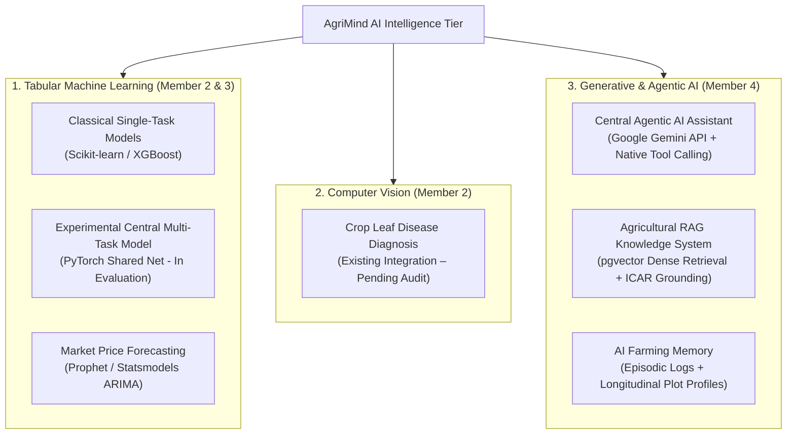
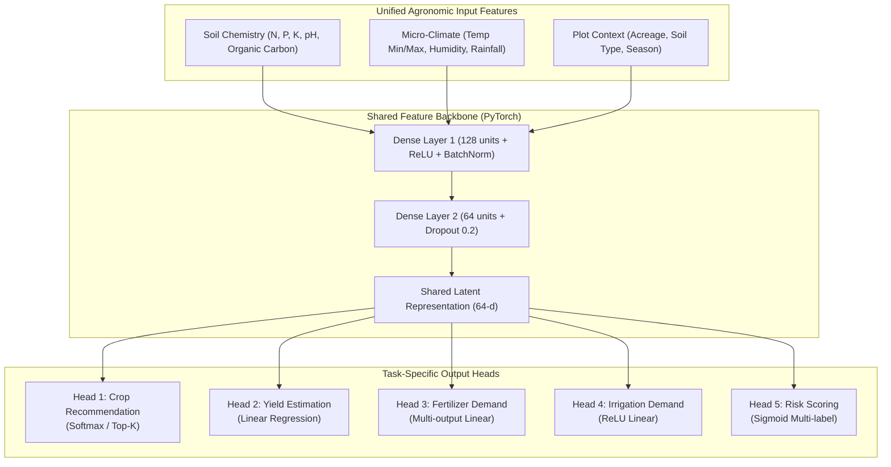

# 09. Machine Learning & Artificial Intelligence Architecture — AgriMind AI

## Document Information
- **Project Name:** AgriMind AI
- **Document Version:** 2.0.0 (Architecture Finalization Specification)
- **Scope:** Machine Learning Architecture, Experimental Multi-Task Protocol, Agentic AI Tool Calling, and RAG Grounding
- **Target Audience:** Member 2 (Crop ML), Member 3 (Market ML), Member 4 (Agentic AI), Evaluators, and AI Coding Agents

---

## 1. AI Taxonomy & Architectural Demarcation

AgriMind AI maintains clear architectural boundaries between the diverse AI and ML paradigms utilized across the platform:



### Paradigms Overview
1. **Classical Machine Learning (Scikit-learn, XGBoost):** Fast, interpretable tabular models serving as standard baselines for crop suitability, yield prediction, and risk scoring.
2. **Deep Multi-Task Learning (PyTorch):** An experimental shared-backbone neural network exploring whether joint representation learning improves generalization across related agronomic tasks.
3. **Time-Series Forecasting (Statsmodels, Prophet):** Specialized statistical and autoregressive models analyzing historical mandi modal prices across regional APMCs.
4. **Computer Vision (External Predecessor API):** High-accuracy leaf image pathology classification inherited from the KisanSathi prototype.
5. **Agentic AI (Gemini API with Native Tool Calling):** Modular reasoning core parsing natural-language farmer intents and invoking approved FastAPI platform services.
6. **Retrieval-Augmented Generation (RAG with pgvector):** Semantic vector search grounding LLM responses in verified agricultural research manuals to systematically reduce hallucination risk.

---

## 2. Central Agricultural Multi-Task Model (Member 2)

### 2.1 Theoretical Concept & Potential Tasks
Agronomic outcomes are interconnected by common physical, chemical, and biological determinants. Soil nutrient levels (N, P, K), pH, moisture, temperature, rainfall, and seasonal photoperiod simultaneously influence:

1. **Task 1: Crop Recommendation** (Multi-class classification $\to$ Top-$k$ suitable crop varieties).
2. **Task 2: Yield Estimation** (Continuous regression $\to$ Expected quintals per acre).
3. **Task 3: Fertilizer Demand** (Multi-output regression $\to$ Recommended N, P, K kg/ha).
4. **Task 4: Irrigation Requirement** (Continuous regression $\to$ Net water volume in mm/liters).
5. **Task 5: Agricultural Risk Score** (Multi-label classification $\to$ Drought, waterlogging, or frost risk).

An experimental Multi-Task Learning (MTL) architecture evaluates whether extracting a shared latent representation across these tasks can improve feature efficiency.



### 2.2 Mandatory Experimental Governance

> [!WARNING]
> **Experimental Status & Comparison Mandate:**  
> The Central Agricultural Multi-Task Model is strictly **experimental**. In tabular machine learning domains, tree-based gradient boosted models (such as XGBoost and LightGBM) frequently outperform deep neural networks. Furthermore, multi-task learning carries the risk of **negative transfer**, where gradient updates for one task degrade performance on another.
>
> **Mandatory Rule:**  
> Member 2 must train and evaluate individual single-task baseline models (**Scikit-learn Random Forests** and **XGBoost Regressors/Classifiers**) for every task *before* adopting the multi-task model. The multi-task network will only be deployed to production if empirical evaluation demonstrates equal or superior performance over single-task baselines.

---

## 3. Specialist Machine Learning & Vision Services

### 3.1 Market Price Forecasting Model (Member 3)
- **Domain:** Univariate and multivariate time-series forecasting.
- **Model Candidates:** **Facebook Prophet**, **Statsmodels SARIMAX**, or **XGBoost with temporal lag features** (lags at $t-1, t-7, t-30$, rolling standard deviation).
- **Decoupling Rationale:** Agricultural commodity markets are influenced by macroeconomic trade flows, export restrictions, and regional market arrivals, which operate independently of local farm soil chemistry.

### 3.2 Crop Leaf Disease Detection API (Member 2)
- **Status:** `Existing Integration – Pending Audit`.
- **Implementation Strategy:** AgriMind AI reuses the existing CNN-based crop disease diagnosis service developed in the predecessor KisanSathi prototype. Member 2 will develop a FastAPI client proxy that validates image inputs, manages retries, and returns structured diagnosis cards.
- **Scope Rule:** No new image training or CNN fine-tuning will be performed within AgriMind AI.

---

## 4. Modular Agentic AI Architecture (Member 4)

AgriMind AI initially implements a **single-agent tool-calling architecture** using the **Google Gemini API**:

```
[Farmer Natural Language Request]
             │
             ▼
[LLM Reasoning & Intent Recognition (Gemini API)]
             │
             ▼
[Native Tool Calling Dispatch]
  ├── Tool 1: get_farm_finances()
  ├── Tool 2: check_inventory_stock()
  ├── Tool 3: get_crop_recommendation()
  └── Tool 4: query_agricultural_knowledge()
             │
             ▼
[FastAPI Endpoints & Domain Services]
             │
             ▼
[PostgreSQL Database / Vector Store / ML Models]
             │
             ▼
[Structured Observations Returned to LLM]
             │
             ▼
[Synthesized Response with Citations & Context]
```

*Architectural Policy:* Do not implement complex multi-agent swarms unless a concrete operational advantage is proven. For single-farm operations, a unified tool-calling agent provides lower latency, predictable execution, and simpler debugging.

---

## 5. RAG Knowledge System & Realistic Hallucination Reduction (Member 4)

AgriMind AI explicitly rejects claims of "zero hallucinations" or "guaranteed correctness." The platform acknowledges that LLMs are probabilistic text generators and implements a six-pillar strategy to systematically minimize hallucination risk:

1. **Curated Agricultural Grounding:** The vector store indexes only verified agricultural literature:
   - ICAR (Indian Council of Agricultural Research) package of practices.
   - State Agricultural University (SAU) crop cultivation manuals.
   - Krishi Vigyan Kendra (KVK) seasonal advisory bulletins.
2. **Dense Vector Retrieval:** Documents are chunked (500 tokens, 50 overlap) and embedded using `sentence-transformers/all-MiniLM-L6-v2` into PostgreSQL using `pgvector`.
3. **Mandatory Source Citations:** Every advisory generated by the assistant must cite the source publication, edition year, and section.
4. **Explicit Uncertainty:** When context documents contain ambiguous or competing recommendations, the assistant explicitly states the uncertainty.
5. **Appropriate Abstention:** When the cosine similarity score of retrieved chunks is below threshold, the assistant abstains from answering, stating: *"Official agricultural extension guidance is unavailable for this specific scenario. Please consult a local agricultural extension officer."*
6. **Domain Boundary Enforcement:** Out-of-domain queries (e.g., medical, financial trading, general trivia) are politely declined.

### RAG Evaluation Framework
All knowledge retrieval responses will be audited using the following six criteria:

| Metric | Target Standard | Evaluation Method |
| :--- | :---: | :--- |
| **Retrieval Relevance** | $\ge 85\%$ | Ratio of retrieved chunks that address the query. |
| **Answer Faithfulness** | $\ge 90\%$ | Ratio of claims strictly supported by retrieved context. |
| **Citation Accuracy** | $100\%$ | Verification that cited source and section exist. |
| **Agricultural Correctness** | $100\%$ | Agronomist review of chemical dosages and toxicity warnings. |
| **Unsupported Claims** | $\le 5\%$ | Frequency of generated statements lacking retrieved evidence. |
| **Appropriate Abstention** | $\ge 95\%$ | Success rate in declining out-of-domain or ungrounded queries. |

---

## 6. Dataset Governance & Experiment Tracking

> [!CAUTION]
> **Strict Empirical Integrity Directive:**  
> All datasets must be rigorously inspected, verified, and cleaned before model training begins. **No team member or AI coding agent may invent dataset sizes, synthetic accuracy figures, or fictional $R^2$ metrics.** All reported metrics must originate from documented, reproducible benchmark runs.

### 6.1 Dataset Tracking Template
```markdown
### Dataset Entry: DS-[ID]
- **Dataset Name:** [Official name of dataset]
- **Target Task:** [e.g., Crop Recommendation / Mandi Price Forecasting]
- **Primary Source:** [e.g., Data.gov.in / ICAR / Kaggle / APMC Portal]
- **Verified Download URL:** [Accessible URL]
- **License:** [e.g., Creative Commons, OGD India]
- **Geographic Coverage:** [e.g., India - Maharashtra State / National]
- **Temporal Coverage:** [e.g., 2018-01-01 to 2025-12-31]
- **Record Count & Size:** [Verified row count and file size on disk]
- **Input Features:** [List of input columns and data types]
- **Target Variable(s):** [Target column name(s) and units]
- **Data Quality:** [Missing value %, duplicate check, outlier analysis]
- **Preprocessing:** [Imputation, scaling, one-hot encoding, train/test split]
- **Split Ratios:** [e.g., 70% Train, 15% Validation, 15% Test]
- **Audit Status:** [Pending Verification / Verified by Member X on YYYY-MM-DD]
```

### 6.2 Model Experiment Tracking Template
```markdown
### Experiment Run: EXP-[MODULE]-[NUMBER]
- **Date & Time:** [YYYY-MM-DD HH:MM UTC]
- **Engineer:** [Member 2 / Member 3]
- **Target Task:** [e.g., Multi-Task Crop & Yield vs. XGBoost Baseline]
- **Dataset Reference:** [Dataset ID, e.g., DS-01]
- **Model Architecture:** [e.g., XGBoost Regressor vs. PyTorch Shared Net]
- **Hyperparameters:** [Learning rate, max_depth, n_estimators, batch size]
- **Validation Metrics:**
  - Classification: [Accuracy, Macro F1, Precision, Recall]
  - Regression: [MAE, RMSE, R² Score]
- **Test Set Metrics:** [Evaluated on unseen test split]
- **Inference Latency:** [Milliseconds per inference on CPU]
- **Conclusion:** [Did the model outperform the baseline? Document decision.]
```

---

## 7. Model Evaluation Log (Active Record)

| Exp ID | Task | Model Architecture | Validation Metric | Test Metric | Status | Notes |
| :---: | :--- | :--- | :---: | :---: | :---: | :--- |
| **EXP-001** | Crop Recommendation | Scikit-learn Random Forest | *Pending Run* | *Pending Run* | **Not Started** | Single-task baseline. |
| **EXP-002** | Crop Recommendation | XGBoost Classifier | *Pending Run* | *Pending Run* | **Not Started** | Single-task gradient boosting. |
| **EXP-003** | Multi-Task Engine | PyTorch Shared Net (5 Heads)| *Pending Run* | *Pending Run* | **Not Started** | Experimental joint model evaluation. |
| **EXP-004** | Market Price Forecast| Statsmodels / Prophet | *Pending Run* | *Pending Run* | **Not Started** | 30-day commodity price forecast baseline. |
| **EXP-005** | Market Price Forecast| XGBoost (Lagged Features) | *Pending Run* | *Pending Run* | **Not Started** | Lagged regression comparison. |
