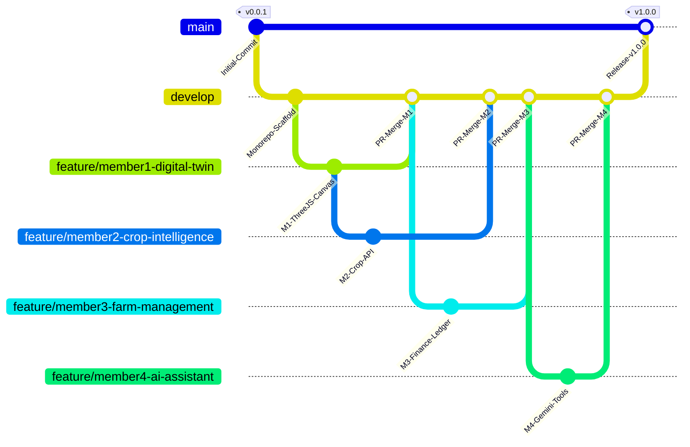
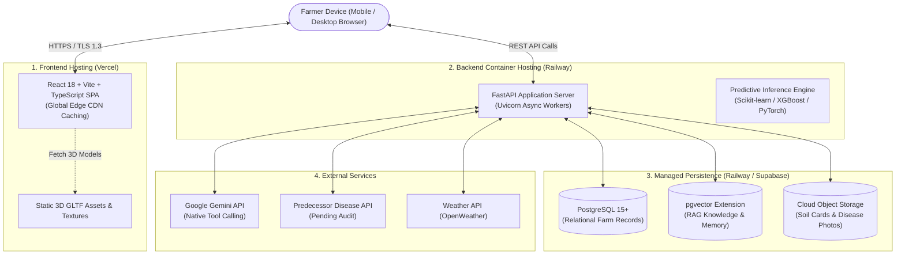

# 10. Deployment Architecture & Git Workflow — AgriMind AI

## Document Information
- **Project Name:** AgriMind AI
- **Document Version:** 2.0.0 (Architecture Finalization Specification)
- **Scope:** Source Code Governance, Git Branching Standards, CI/CD, and Cloud Deployment
- **Target Audience:** All Team Members, Evaluators, and AI Coding Agents

---

## 1. Git Repository Architecture & Branching Strategy

AgriMind AI implements a structured **GitFlow-inspired branching strategy** optimized for four student engineering contributors. Direct commits to `main` and `develop` are strictly prohibited via GitHub branch protection rules.



---

## 2. Standard Branch Taxonomy

| Branch Name | Base Branch | Access Control | Purpose |
| :--- | :--- | :--- | :--- |
| **`main`** | *Root* | Protected; Admin Only | Production releases. Code must be stable, tested, and approved by all 4 members. |
| **`develop`** | `main` | Protected; PR Approval Required | Integration branch for staging. Completed member feature PRs merge here. |
| **`feature/member1-digital-twin`** | `develop` | Member 1 (Lead) | Three.js WebGL canvas, farm setup wizard, what-if simulator, machinery rental. |
| **`feature/member2-crop-intelligence`** | `develop` | Member 2 (Lead) | Crop recommendation, soil cards, irrigation, disease proxy, multi-task ML. |
| **`feature/member3-farm-management`** | `develop` | Member 3 (Lead) | Financial ledgers, inventory, labor payroll, market price forecasting. |
| **`feature/member4-ai-assistant`** | `develop` | Member 4 (Lead) | Gemini tool calling, RAG knowledge pipeline, voice assistant, offline PWA. |
| **`bugfix/<issue-name>`** | `develop` | Any Member | Short-lived branch to resolve integration defects or test failures. |
| **`hotfix/<issue-name>`** | `main` | Team Consensus | Urgent production fixes applied directly to `main` and back-merged to `develop`. |

---

## 3. Pull Request & Code Review Protocols

Before any Pull Request (PR) is merged into `develop`:

1. **Conventional Commits:** PR title must follow the standard (e.g., `feat(twin): implement Three.js camera orbit controls`).
2. **Automated CI Validation:** GitHub Actions workflows must pass:
   - TypeScript compile check (`tsc --noEmit`).
   - Frontend linting (`eslint`).
   - Python code formatting (`black --check`, `flake8`).
   - Backend unit tests (`pytest`).
3. **Peer Review:** Requires at least **one peer review approval** from a team member whose module integrates with the PR.
4. **No Merge Conflicts:** The branch must be rebased against current `develop` prior to merging.
5. **Merge Method:** Use **Squash and Merge** to maintain a clean linear commit history on `develop`.

---

## 4. Conflict Resolution Strategy

When merge conflicts occur between member branches:

```powershell
# 1. Switch to your feature branch
git checkout feature/memberX-your-module

# 2. Fetch the latest changes from develop
git fetch origin develop

# 3. Rebase your feature branch on top of develop
git rebase origin/develop

# 4. If conflicts occur, inspect and resolve each conflict in VS Code
# 5. After resolving, stage the resolved files
git add <resolved-file>

# 6. Continue rebase
git rebase --continue

# 7. Force-push the rebased branch to your remote branch safely
git push origin feature/memberX-your-module --force-with-lease
```

---

## 5. Cloud Deployment Architecture (Finalized)

AgriMind AI deploys to a modern, student-friendly PaaS infrastructure:



---

## 6. Component-Wise Deployment Setup

### 6.1 Frontend Deployment on Vercel
- **Framework Preset:** Vite
- **Build Command:** `npm run build`
- **Output Directory:** `dist`
- **Configuration (`vercel.json`):**
  ```json
  {
    "rewrites": [
      { "source": "/api/(.*)", "destination": "https://api.agrimind.railway.app/api/$1" },
      { "source": "/(.*)", "destination": "/index.html" }
    ]
  }
  ```

### 6.2 Backend Deployment on Railway
- **Deployment Method:** Dockerfile or Railway Python Nixpacks.
- **Dockerfile:**
  ```dockerfile
  FROM python:3.11-slim
  WORKDIR /app
  RUN apt-get update && apt-get install -y --no-install-recommends libpq-dev gcc && rm -rf /var/lib/apt/lists/*
  COPY requirements.txt .
  RUN pip install --no-cache-dir -r requirements.txt
  COPY . .
  EXPOSE 8000
  CMD ["uvicorn", "app.main:app", "--host", "0.0.0.0", "--port", "8000", "--workers", "2"]
  ```

### 6.3 Database Deployment (PostgreSQL + pgvector)
- Managed PostgreSQL 15+ instance provisioned on Railway or Supabase.
- Run migrations during build/deploy:
  ```bash
  alembic upgrade head
  ```
- Automated daily database backups with a 7-day retention period.

---

## 7. Monitoring, Backup & Rollback Protocols

1. **Liveness & Health Probes:**
   - `GET /health`: Returns `200 OK` if the FastAPI web process, database connection, and vector extension are operational.
2. **Rollback Procedures:**
   - **Frontend:** Instant rollback in the Vercel dashboard by clicking "Promote to Production" on the previous verified deployment SHA.
   - **Backend:** Roll back Railway deployment to the previous verified container image tag.
   - **Database:** Revert the latest migration via Alembic:
     ```powershell
     alembic downgrade -1
     ```
